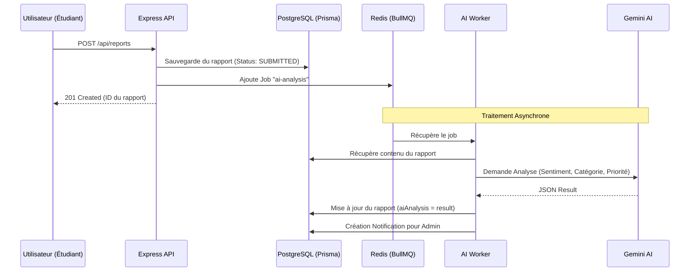

# Flux de Données & Cas d'Usage

Ce document décrit les flux principaux du système, de l'interaction utilisateur au traitement IA en arrière-plan.

## 1. Création d'un Signalement (Feedback Loop)

C'est le flux principal de collecte d'informations.

---

## 2. Évaluation & Notation IA

Flux utilisé pour transformer des avis textuels en scores quantitatifs.

1. **Client** envoie une évaluation via `POST /api/evaluations`.
2. **Système** calcule le score brut basé sur les étoiles (RatingBands).
3. **Queue** enregistre un job `evaluation-scoring`.
4. **AI Worker** analyse le commentaire textuel et propose un `aiScore` (0-20).
5. **Dashboard** affiche la comparaison entre le score utilisateur et la pertinence IA.

---

## 3. Aide à la Décision

Comment les administrateurs bouclent la boucle.

1. Un **Admin** consulte une évaluation négative.
2. Un job `decision-suggestion` est déclenché.
3. L'**IA** analyse l'historique de l'étudiant et du module.
4. L'**IA** propose une action corrective dans le champ `aiSuggestion`.
5. L'**Admin** valide, modifie ou rejette la suggestion pour créer une `Decision`.

---

## 4. Authentification & Sécurité

1. **Login** (`/api/auth/login`) -> Retourne `accessToken` (court terme) et `refreshToken` (long terme).
2. **OTP (Optionnel)** : Si activé, le login renvoie un `challengeId`. L'utilisateur doit appeler `/verify-otp`.
3. **Appels API** : Le client envoie le `Bearer Token` dans le header `Authorization`.
4. **Refresh** : Quand le token expire, le client appelle `/api/auth/refresh` avec son refresh token stocké de manière sécurisée.
